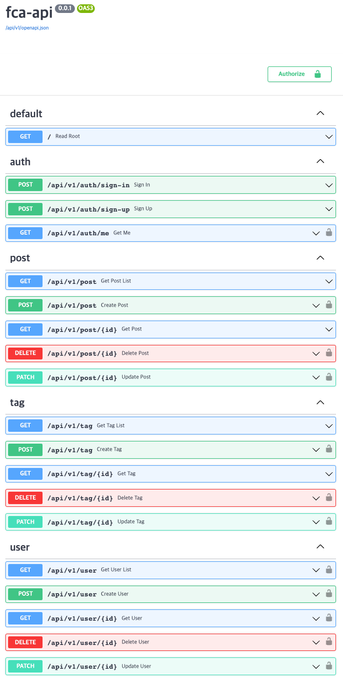
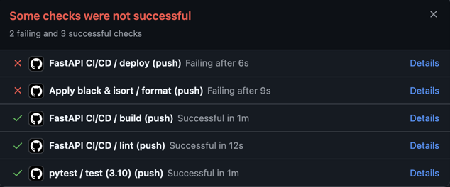
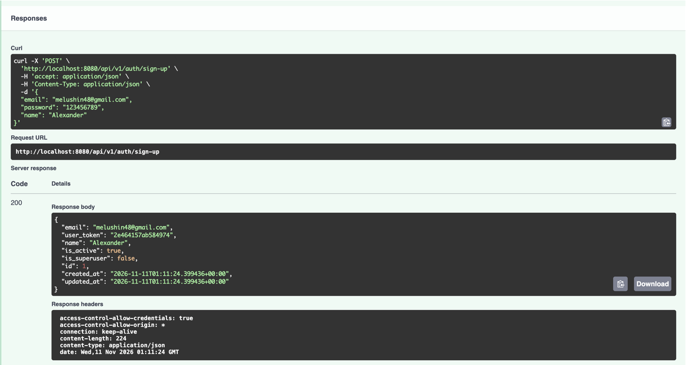
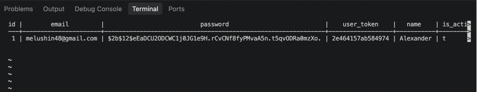

# fastapi-clean-architecture

## description
Base FastAPI project for applying general RestAPI Application cases.


## concept
1. Minimal functionality.
2. Convincing architecture.
3. Easy to read.
4. Compatibility.
5. Versatility.

## base models
1. user
2. post [user (1 : n) post]
3. tag [post (n : n) tag]

## integrated with
1. Python3.9+
2. Fastapi 0.78.0
3. Database
   1. MySQL5.7+
   2. Migration with alembic
   3. pytest with real DB
   4. Load with two ways (eager, lazy)
   5. Modeling with schema (1:1, 1:n, n:n)
4. dependency-injector
   1. service-repository pattern
5. JWT authentication
   1. role separation each endpoint
6. Deployment
   1. container environment(k8s, docker)
   2. raw WAS(Web Application Server)

## commands
1. db(alembic)
   1. `alembic upgrade head`: apply every migrations
   2. `alembic downgrade base`: rollback every migrations
   3. `alembic revision --autogenerate -m "revision_name"`: create new migration 
   4. `alembic history`: get alembic revision history
2. How to migration
   1. Create or modify models from `app/model/*.py`
   2. `alembic -x ENV=[dev|stage|prod] revision --autogenerate -m "revision_name"`
   3. Check auto generated migration file from `app/migrations/versions/*.py`
   4. `alembic -x ENV=[dev|stage|prod] upgrade head`  
      If ENV does not exist, it will be applied to the test.
3. server
   1. `uvicorn app.main:app --reload`: base
   2. options
      1. host: `--host 0.0.0.0`
      2. port: `--port 8000`
4. test
   1. `pytest`: base 
   2. `pytest --cov=app --cov-report=term-missing`: coverage with stdout
   3. `pytest --cov=app --cov-report=html`: coverage with html

## sample env
```dotenv
# mysql case
ENV=dev
DB=mysql
DB_USER=root
DB_PASSWORD=qwer1234
DB_HOST=localhost
DB_PORT=3306

# postgres case
ENV=dev
DB=postgresql
DB_USER=gyu
DB_PASSWORD=
DB_HOST=localhost
DB_PORT=5432
```

## references
1. [FastAPI official docs](https://fastapi.tiangolo.com/)
2. [alembic official tutorial](https://alembic.sqlalchemy.org/en/latest/tutorial.html)
3. [Dependency Injector](https://python-dependency-injector.ets-labs.org/)

---


# DevOps Infrastructure

## Описание

Инфраструктура для развертывания FastAPI приложения с PostgreSQL в K8S с автоматизацией CI/CD через Git Action

---

## Архитектура

### Компоненты:
- **Приложение:** FastAPI (Python 3.10) с Clean Architecture
- **База данных:** PostgreSQL 15
- **Оркестрация:** Kubernetes (локально через Kind)
- **CI/CD:** GitHub Actions
- **Сборка:** Multi-stage Docker с оптимизацией безопасности


## Быстрый старт

### Требования:
- Docker Desktop
- Kind (`brew install kind`)
- kubectl (`brew install kubectl`)
- Git

### Локальный запуск:

```bash
# 1. Клонировать репозиторий
git clone <your-repo-url>
cd fastapi-clean-architecture

# 2. Создать Kubernetes кластер
kind create cluster --name fastapi-test

# 3. Собрать Docker образ
docker build -t fastapi-app:latest .

# 4. Загрузить образ в Kind
kind load docker-image fastapi-app:latest --name fastapi-test

# 5. Применить манифесты Kubernetes
kubectl apply -f k8s/

# 6. Пробросить порт для внешнего доступа
kubectl port-forward -n ingress-nginx svc/ingress-nginx-controller 8080:80

```

## Локальный запуск

- Swagger UI: http://localhost:8080/docs
- Healthcheck: http://localhost:8080/api/health

## CI/CD Пайплайн (GitLab)
Примечание: В репозитории представлен .gitlab-ci.yml для демонстрации понимания синтаксиса GitLab CI. Пайплайн реализован через GitHub Actions (.github/workflows/ci.yml), так как регистрация на GitLab.com из РФ требует верификации иностранными реквизитами.

#### Этапы пайплайна:
1. lint — Проверка кода через flake8:
- Запускается при создании Merge Request
- Блокирует мерж при ошибках
2. build — Сборка Docker образа:
- Запускается только при мерже в main
- Образ тэгируется хэшем коммита ($CI_COMMIT_SHORT_SHA)
Отправляется в GitLab Container Registry
3. deploy — Деплой в Kubernetes:
- Обновляет образ в Deployment
- Применяет манифесты из папки k8s/
- Ждет успешного rollout

### Рабочий процесс разработчика:
1. Создать ветку от main
2. Внести изменения и запушить
3. Создать Merge Request → автоматически запускается lint
4. После ревью — мерж в main
5. Автоматически запускаются build и deploy
6. Отслеживать статус в GitLab → CI/CD → Pipelines

---
## Принятые решения и объяснения

### 1. Multi-stage сборка Docker-image
```
Решение: 
Использован двухэтапные докерфайл с базовым образом python:3.10.13-bookworm на этапе сборки  и python:3.10.13-slim-bookworm на этапе production

Почему:
1. Библиотека psycopg2 требует компиляции C-расширений для поддержки SCRAM PostgreSQL
2. На этапе builder установлены libpq-dev и build-essential для компиляции из исходников 
3. Флаг --no-binary psycopg2 принудительно собирает драйвер из исходников 
4. Финальный образ на базе slim не содержит компиляторов, что уменьшает размер и снижает поверхность атаки
```
### 2. Init-контейнер для миграций базы данных
```
Решение: Миграции Alembic вынесены в initContainer с циклом ожидания готовности PostgreSQL через pg_isready

Почему:
Предотвращает race condition: приложение не стартует, пока база не готова принимать подключения
Гарантирует порядок запуска: БД -> миграции -> приложение
Цикл until pg_isready с интервалом 2 секунды обеспечивает надежное ожидание без hard-coded задержек
При падении миграций под не переходит в статус Running, что предотвращает запуск приложения с неактуальной схемой БД
```

### 3. Безопасность контейнера
```
Решение:
1.Создание непривилегированного пользователя appuser (UID 1000) с группой appgroup
2. Использование tini как init-процесса (ENTRYPOINT)
3. Настройка HEALTHCHECK для мониторинга состояния контейнера
4. Вынос секретов в Kubernetes Secret


Почему:
1. Запуск от root в контейнере — критическая уязвимость, при взломе приложения хакер получает root-доступ внутри контейнера
2. tini корректно обрабатывает сигналы SIGTERM/SIGINT, предотвращая появление зомби-процессов и обеспечивая нормально отключение
3. HEALTHCHECK позволяет оркестратору автоматически перезапускать зависшие контейнеры
4. Секреты в Kubernetes Secret шифруются etcd и не хранятся в открытом виде в манифестах
```

### 4. Иммутабельность образов
```
Решение: Docker-образы тэгируются хэшем коммита, а не latest.

Почему:
Гарантирует воспроизводимость: в кластере всегда запускается именно та версия кода, которая прошла проверки
Позволяет легко откатиться на предыдущую версию, просто изменив тег в Deployment
Исключает ситуацию, когда latest внезапно обновился и сломал production
```

### 5. Конфигурация через ConfigMap и Secret
```
Решение: Все параметры окружения (DB_HOST, DB_USER, ENV и т.д.) вынесены в Kubernetes ConfigMap и Secret, приложение получает их через envFrom.

Почему:
Конфигурация отделяется от кода
Позволяет использовать один и тот же образ для разных окружений, меняя только ConfigMap/Secret
Упрощает ротацию секретов без пересборки образа
```

### 6. Ingress для внешнего доступа
```
Решение: Использован Nginx Ingress Controller вместо NodePort или LoadBalancer.

Почему:
Ingress - production-ready решение для маршрутизации HTTP/HTTPS трафика
Поддерживает виртуальный хостинг
В локальной среде Kind эмулируется через port-forward, в облаке автоматически интегрируется с Load Balancer
```

# Чтобы бы я сделал, если бы было больше времени
```
1. Упаковать Helm-чарт, вместо статических yaml
2. Управление базой данных, автоматическое резервное копирование, обновления, мониторинг. В production БД внутри k8s неправильно, потеря пода = потеря данных, если нету бэкапов
3. Сделать мониторинг. Без него невозможно обнаружить деградацию сервиса, до первых жалоб пользователей.
4. Image-scanning. Сейчас образы не проверяются на уязвимость
5. Сейчас у меня кол-во подов фиксировано. Добавил бы автоматическое маштабирование под нагрузкой, а при низкой нагрузке экономиить ресурсы.
6.Изоляция подов. FastAPI должен иметь доступ только к БД. Запрет исходящего трафика в интернет, только необходимые API. least privilege на сетевом уровне.
```

# Вопросы команде перед внедрением в реальный проект

1. Где будет размещен Kubernetes-кластер (облачный провайдер или собственные сервера)?
2. Как организованы бэкапы базы данных PostgreSQL и какова процедура восстановления в случае сбоя?
3. Где и как физически хранятся данные базы данных в кластере?
4. Где и как безопасно хранить пароли и ключи доступа?
5. Требуется ли автоматическая проверка Docker-образов на уязвимости перед деплоем?
6. Как устроен процесс релиза? Требуется ли ручное одобрение перед выкаткой на production-окружение?
7. Каким образом и как быстро можно откатить версию приложения, если после деплоя обнаружены критические ошибки?
8. Куда собираются логи приложения и базы данных, и как настроены уведомления при падении сервиса или ошибках?
9. Ожидается ли высокая нагрузка на сервис, требующая настройки автоматического масштабирования количества подов?

---
# Скриншоты
1. Пайплайн в GitHub:
#### 
2. Сервис отвечает на запросы:
#### 
3. Данные запросов сохраняются в PostgreSQL
#### 